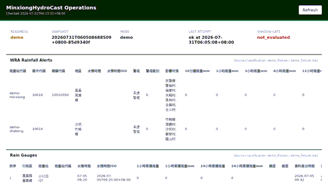

# 快速開始

MinxiongHydroCast 整理民雄／嘉義的官方水文氣象觀測，並提供可重現的降雨臨近預報
研究流程。先用合成資料示範了解介面與狀態，再決定是否設定官方資料來源。

## 使用 Docker 示範

在已安裝 Docker Compose 的環境下載專案：

```bash
git clone https://github.com/KageRyo/MinxiongHydroCast.git
cd MinxiongHydroCast
docker compose up --build
```

開啟 <http://127.0.0.1:8080/>。這是本機操作介面，使用合成雨量站與淹水感測器資料，
不需要 API key，也不發送官方資料請求。若 8080 已被占用：

```bash
MHC_DEMO_PORT=18080 docker compose up --build
```

此時開啟 <http://127.0.0.1:18080/>。結束時按 `Ctrl+C`，再執行 `docker compose down`。

## 預期看到什麼？

| 項目 | 示範的預期結果 | 代表意義 |
| --- | --- | --- |
| `/healthz` | HTTP 200 | API 程序可以回應 |
| `/readyz` | HTTP 503，`ready=false` | 合成資料不能滿足正式資料就緒條件 |
| 觀測資料 | `mode=demo` | 介面展示用，不代表目前天氣 |
| 預報端點 | `available=false` | 模型與 shadow 條件尚未全部通過 |

示範的 503 是預期行為；不能因此把資料新鮮度或模型門檻調低。
完整回應與判讀請見 [API 文件](api_reference.md)。



此動畫使用合成資料。公開文件站本身是靜態網站，沒有連接私人部署的即時資料。

## 使用 Python

CI 驗證 Python 3.11 與 3.13。從專案根目錄執行：

```bash
python3 -m venv .venv
source .venv/bin/activate
python -m pip install -e .
mhc collect --region minxiong --mode demo --once
mhc serve --host 127.0.0.1 --port 8080
```

Windows 的虛擬環境啟用方式為 `.venv\Scripts\Activate.ps1`。
預設資料會留在忽略的本機資料目錄；API 以唯讀方式讀取觀測快照。

## 下一步

- 使用官方觀測：[操作指南](operational_use.md)與[單機部署](single_host_operations.md)。
- 重現模型研究：[資料資產](data_assets.md)、[事件切分](event_splits.md)與[基準結果](baseline_results.md)。
- 修改程式或文件：[貢獻入口](contributing.md)。
- 確認可以與不可以宣稱的能力：[專案範圍](project_scope.md)與[模型卡](model_cards/minxiong_chiayi_baseline.md)。
